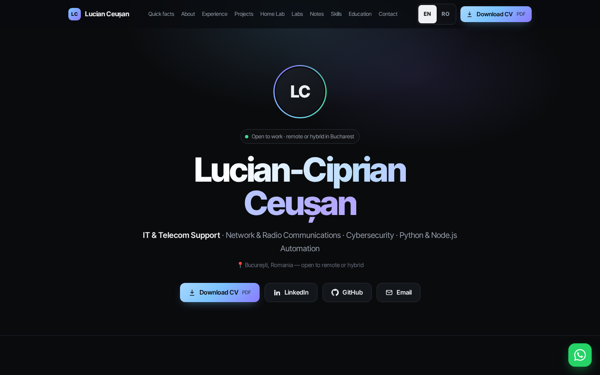
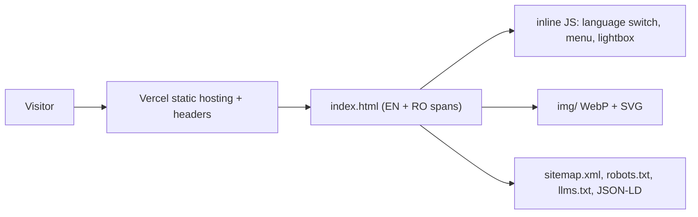
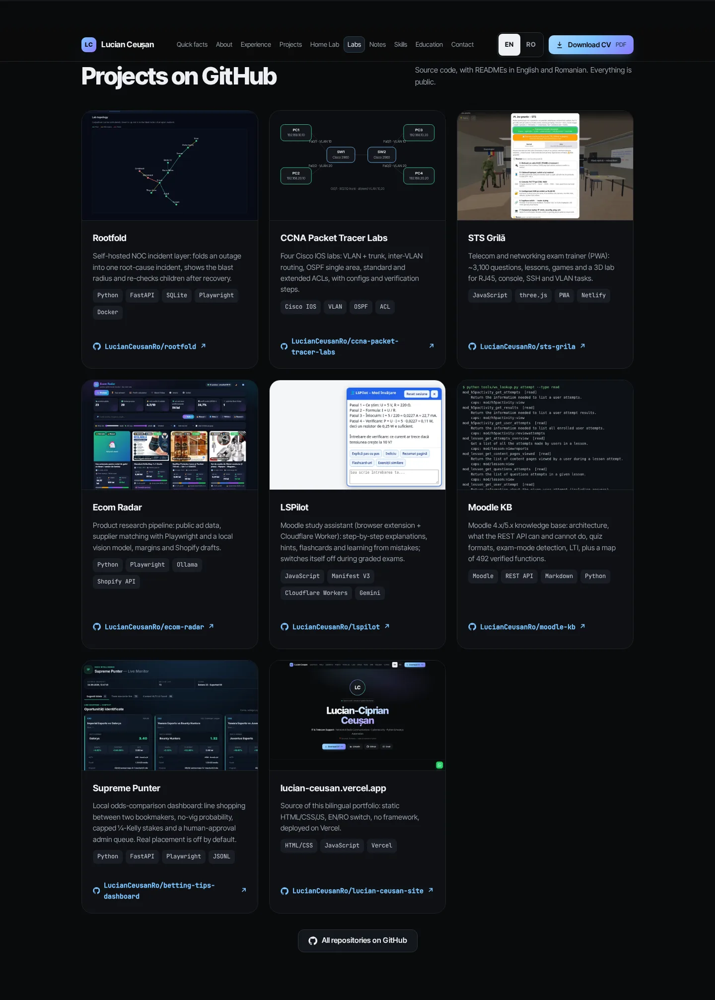
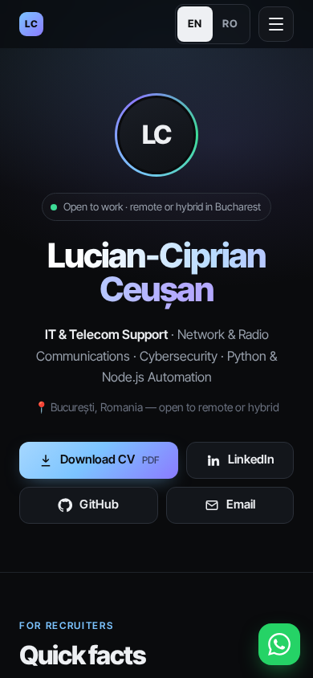

<div align="center">

<br>

# lucian-ceusan.vercel.app

**My bilingual (EN/RO) portfolio — one static page, no framework, no build.**

  <a href="https://lucian-ceusan.vercel.app"></a>
  <a href="https://github.com/LucianCeusanRo/lucian-ceusan-site/actions/workflows/ci.yml"></a>
  <a href="LICENSE"></a>
  
  <a href="https://github.com/LucianCeusanRo/lucian-ceusan-site/stargazers"></a>
  <a href="https://github.com/LucianCeusanRo/lucian-ceusan-site/commits/main"></a>

[English](#-about) · [Română](#-română)

</div>

<p align="center"></p>

<p align="center"><strong><a href="https://lucian-ceusan.vercel.app">▶ Live demo</a></strong> — open it in the browser and try it yourself.</p>

## 📑 Table of contents

- [📖 About](#-about)
- [✨ Features](#-features)
- [🧠 How it works](#-how-it-works)
- [⚡ Quick start](#-quick-start)
- [📚 Step-by-step tutorial](#-step-by-step-tutorial)
- [🖼️ Screenshots](#-screenshots)
- [🔧 Configuration](#-configuration)
- [🗂️ Project structure](#-project-structure)
- [⚠️ Limitations](#-limitations)
- [❓ FAQ](#-faq)
- [🗺️ Roadmap](#-roadmap)
- [🤝 Contributing](#-contributing)
- [📄 License](#-license)
- [🇷🇴 Română](#-română)
- [👤 Author](#-author)

## 📖 About

Source of my bilingual (English / Romanian) portfolio site: https://lucian-ceusan.vercel.app

- **Used for:** one link I can send to recruiters and employers that shows, in English or Romanian, my telecom & network work, my projects with real screenshots, my labs and a way to contact me.
- **Helps:** recruiters who need the facts fast ("quick facts" block at the top); and anyone who wants a simple bilingual portfolio template without a framework — fork it and replace the text and images.

## ✨ Features

- ✨ One static page, no framework and no build step: HTML, CSS and a small vanilla JS file inlined in `index.html`.
- 🔎 EN / RO language switch (remembers the choice, `?lang=ro` link), responsive layout, mobile menu.
- ⚙️ Sections: quick facts for recruiters, about, experience, projects with screenshot gallery (lightbox), home lab, Packet Tracer labs with topology diagrams, projects on GitHub, skills, education, contact form (opens the visitor's email app).
- 📊 SEO basics: Open Graph image, JSON-LD `ProfilePage`, `sitemap.xml`, `robots.txt`, `llms.txt`, hreflang links.
- 🛡️ Security headers and caching set in `vercel.json`.

## 🧠 How it works



Every text exists twice (`<span class="en">` / `<span class="ro">`); a small script toggles the language, remembers the choice and supports `?lang=ro`.

**Tech stack:** HTML5, CSS3, vanilla JavaScript, SVG, WebP, Vercel.

## ⚡ Quick start

```bash
git clone https://github.com/LucianCeusanRo/lucian-ceusan-site.git && cd lucian-ceusan-site
python3 -m http.server 8000      # open http://127.0.0.1:8000
```

## 📚 Step-by-step tutorial

### 1. Run locally
```bash
git clone https://github.com/LucianCeusanRo/lucian-ceusan-site.git && cd lucian-ceusan-site
python3 -m http.server 8000     # then open http://127.0.0.1:8000  (any static server works)
```
No `.env`, no dependencies, no build.
### 2. Edit
1. Change a text: search for it in `index.html` and edit **both** the `en` and the `ro` span.
2. Add a project card: copy one `<article class="repo-card">` block inside `<section id="github">`, change the link, image (`img/repos/*.webp`, 960×600), title, two descriptions and the stack tags.
3. Check `?lang=ro` and a phone-width window before publishing.
### 3. Deploy
```bash
npx vercel          # preview URL
npx vercel --prod   # production
```
The CV PDFs linked from the page (`/Lucian_Ceusan_CV.pdf`, `/Lucian_Ceusan_CV_RO.pdf`) are added at deploy time and are not stored in this repository.

## 🖼️ Screenshots

| Projects on GitHub | Mobile |
| --- | --- |
|  |  |

## 🔧 Configuration

No configuration, dependencies or secrets. Headers and caching are in `vercel.json`.

## 🗂️ Project structure

```
index.html  favicon.svg  og.png  vercel.json  sitemap.xml  robots.txt  llms.txt
img/        screenshots, lab diagrams, repo card images (img/repos/)
docs/screenshots/   images used in this README
```

## ⚠️ Limitations

- One big `index.html`: simple to host, but every edit is manual (no templating, no CMS).
- The contact form only opens the visitor's e-mail app (`mailto:`); there is no backend.
- Every text must be kept in sync in two languages by hand.

---

## ❓ FAQ

<details><summary><b>Can I use it as a template?</b></summary>

Yes (MIT for the code). Replace texts, images and personal data with your own.

</details>

<details><summary><b>Where is the CV?</b></summary>

The PDFs are added at deploy time and are not stored in the repository.

</details>

## 🗺️ Roadmap

- [ ] Dark/light theme toggle
- [ ] Automated link and accessibility check in CI

## 🤝 Contributing

Issues and pull requests are welcome. Please keep changes small, describe how you tested them, and never commit real credentials — use `.env` (git-ignored) and update `.env.example` with placeholders only.

## 📄 License

MIT for the code — see [LICENSE](LICENSE). Text, CV and personal images © Lucian-Ciprian Ceușan.

## 🇷🇴 Română

<details>
<summary><b>Click pentru versiunea în limba română</b></summary>

Codul sursă al site-ului meu de portofoliu, bilingv (engleză / română): https://lucian-ceusan.vercel.app

#### Funcționalități
- O singură pagină statică, fără framework și fără build: HTML, CSS și puțin JavaScript simplu, incluse în `index.html`.
- Comutare EN / RO (ține minte alegerea, link cu `?lang=ro`), layout responsive, meniu pe mobil.
- Secțiuni: pe scurt pentru recrutori, despre, experiență, proiecte cu galerie de capturi, home lab, laboratoare Packet Tracer cu diagrame, proiecte pe GitHub, competențe, educație, formular de contact (deschide aplicația de email a vizitatorului).
- SEO de bază: imagine Open Graph, JSON-LD, `sitemap.xml`, `robots.txt`, `llms.txt`, hreflang.
- Header-e de securitate și cache în `vercel.json`.

#### La ce folosește și pe cine ajută
- **Folosește la:** un singur link pe care îl trimit recrutorilor, cu experiența mea în telecom și rețele, proiectele cu capturi reale, laboratoarele și datele de contact, în engleză sau română.
- **Ajută:** recrutorii care vor faptele repede; și pe oricine vrea un șablon simplu de portofoliu bilingv, fără framework.

#### Arhitectură
Un singur `index.html` cu fiecare text de două ori (`en` / `ro`), CSS și JS inline (comutare limbă, meniu mobil, lightbox), imagini în `img/`, header-e de securitate în `vercel.json`.

#### Tehnologii
HTML5, CSS3, JavaScript simplu, SVG, imagini WebP, Vercel.

#### Tutorial
1. **Local:** `python3 -m http.server 8000` și deschizi http://127.0.0.1:8000 (fără `.env`, fără dependențe, fără build).
2. **Editare:** cauți textul în `index.html` și schimbi ambele variante (`en` și `ro`); pentru un proiect nou copiezi un bloc `<article class="repo-card">` din `<section id="github">` și schimbi linkul, imaginea (960×600), titlul, descrierile și etichetele.
3. **Publicare:** `npx vercel --prod`. CV-urile PDF se adaugă la deploy, nu sunt în repo.


#### Structura proiectului
`index.html`, `img/`, `vercel.json`, `sitemap.xml`, `robots.txt`, `llms.txt`, `docs/screenshots/`.

#### Limitări
- Un singur `index.html` mare: editare manuală, fără CMS.
- Formularul de contact doar deschide aplicația de e-mail (`mailto:`), fără backend.
- Textele trebuie ținute sincron manual în două limbi.

</details>

## 👤 Author

**Lucian-Ciprian Ceușan** — telecom & network technician, Bucharest, Romania

[](https://lucian-ceusan.vercel.app) [](https://www.linkedin.com/in/lucian-ceusan-7a9179210) [](https://github.com/LucianCeusanRo)
